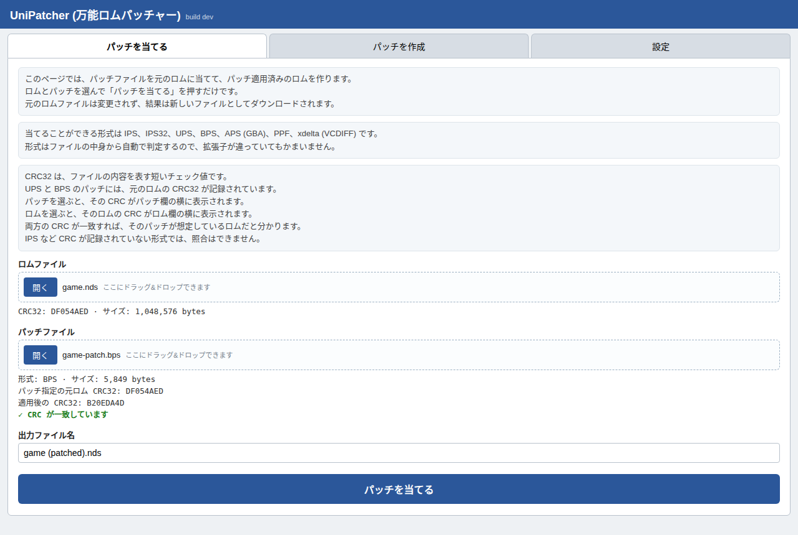
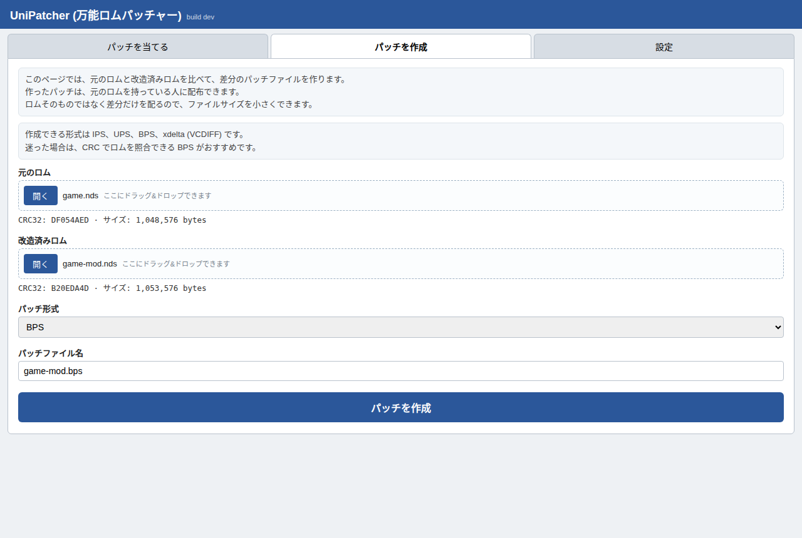
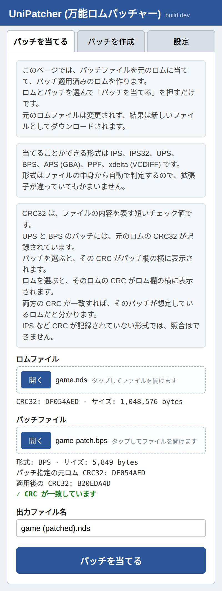
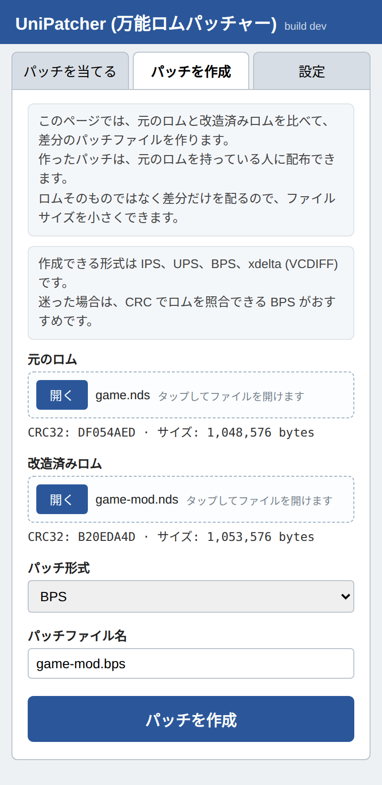

# UniPatcher (万能ロムパッチャー)

UniPatcher is a standalone tool that applies ROM patches in many formats and can also create patches.

No installation is needed; just run the exe.

## Screenshots

The "Apply patch" screen on PC.

The CRC is shown for both the ROM and the patch, and you can see that they match.

The "Create patch" screen on PC.

The "Apply patch" screen on a smartphone.

On the smartphone version, no drag & drop wording is shown.

The "Create patch" screen on a smartphone.

## What it does

On the "Apply patch" page, you apply a patch file to an original ROM and get a patched ROM.

The original ROM file is never changed, and the result is downloaded as a new file.

On the "Create patch" page, you compare an original ROM with a modified ROM and create a patch file of the differences.

You can give the patch to anyone who owns the original ROM.

Only the differences are shared, so the patch file stays small.

Every file field supports both clicking to open a file and drag & drop.

## Supported formats

You can apply IPS, IPS32, UPS, BPS, APS (GBA), PPF (1.0/2.0/3.0) and xdelta (VCDIFF) patches.

You can create IPS, UPS, BPS and xdelta (VCDIFF) patches.

The format is detected from the file contents, so a wrong file extension is not a problem.

Patches that use xdelta secondary compression (such as FGK) are not supported, and an error is shown for them.

## About CRC

CRC32 is a short checksum that represents the contents of a file.

UPS and BPS patches store the CRC32 of the original ROM they expect.

When you choose a patch, that CRC is shown next to the patch field.

When you choose a ROM, the ROM's CRC is shown next to the ROM field.

If both CRCs match, you know the patch was made for that ROM.

Formats that store no CRC, such as IPS, cannot be checked this way.

On the Settings page, you can choose what happens when the CRC does not match: warn and let you choose, stop, or do not check.

## Settings

The display language can be chosen from 12 languages, and the default is the system language.

Showing MD5 and SHA-1 can also be toggled on the Settings page.

Settings are saved on this device automatically and are used again on the next start.

---

UniPatcher は、いろいろな形式のロムパッチを当てたり、パッチを作ったりできる単体のソフトです。

インストールは不要で、exe を起動するだけで使えます。

## スクリーンショット

PC 版の「パッチを当てる」画面です。

ロムとパッチの両方に CRC が表示され、一致していることも分かります。

PC 版の「パッチを作成」画面です。

スマホ版の「パッチを当てる」画面です。

スマホ版では、ドラッグ&ドロップの表記は出ません。

スマホ版の「パッチを作成」画面です。

## できること

「パッチを当てる」ページでは、パッチファイルを元のロムに当てて、パッチ適用済みのロムを作ります。

元のロムファイルは変更されず、結果は新しいファイルとしてダウンロードされます。

「パッチを作成」ページでは、元のロムと改造済みロムを比べて、差分のパッチファイルを作ります。

作ったパッチは、元のロムを持っている人に配布できます。

ロムそのものではなく差分だけを配るので、ファイルサイズを小さくできます。

すべてのファイル欄は、クリックしてファイルを開く操作と、ドラッグ&ドロップの両方に対応しています。

## 対応形式

当てることができる形式は IPS、IPS32、UPS、BPS、APS (GBA)、PPF (1.0/2.0/3.0)、xdelta (VCDIFF) です。

作成できる形式は IPS、UPS、BPS、xdelta (VCDIFF) です。

形式はファイルの中身から自動で判定するので、拡張子が違っていてもかまいません。

xdelta の二次圧縮 (FGK など) が使われているパッチは未対応で、その場合はエラーが表示されます。

## CRC について

CRC32 は、ファイルの内容を表す短いチェック値です。

UPS と BPS のパッチには、元のロムの CRC32 が記録されています。

パッチを選ぶと、その CRC がパッチ欄の横に表示されます。

ロムを選ぶと、そのロムの CRC がロム欄の横に表示されます。

両方の CRC が一致すれば、そのパッチが想定しているロムだと分かります。

IPS など CRC が記録されていない形式では、照合はできません。

設定ページでは、CRC が一致しないときの動きを「警告して選べる」「中止する」「チェックしない」から選べます。

## 設定

表示言語は12言語から選べ、初期値はシステム言語です。

MD5 と SHA-1 の表示も設定ページで切り替えられます。

設定はこの端末に自動で保存され、次回起動時にも使われます。
